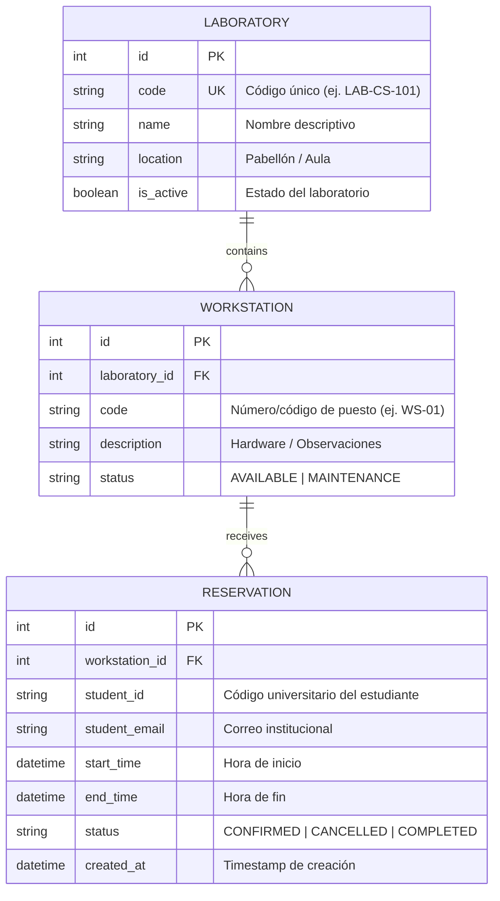

# Data Model: Sistema de Reservas de Laboratorios (LabReserve)

## Entidades y Relaciones

## Reglas de Invariante de Datos

1. **Unicidad de Puesto en Laboratorio:** `(laboratory_id, code)` debe ser único.
2. **Duración de Reserva:** `end_time - start_time <= 2 hours` y `end_time > start_time`.
3. **Restricción de Estado de Reserva:** Solo las reservas en estado `CONFIRMED` computan para:
   - Solapamiento de horario en un puesto.
   - Restricción de 1 reserva activa por estudiante.
